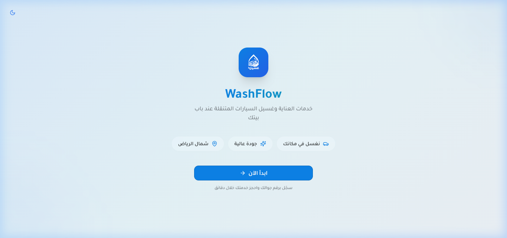
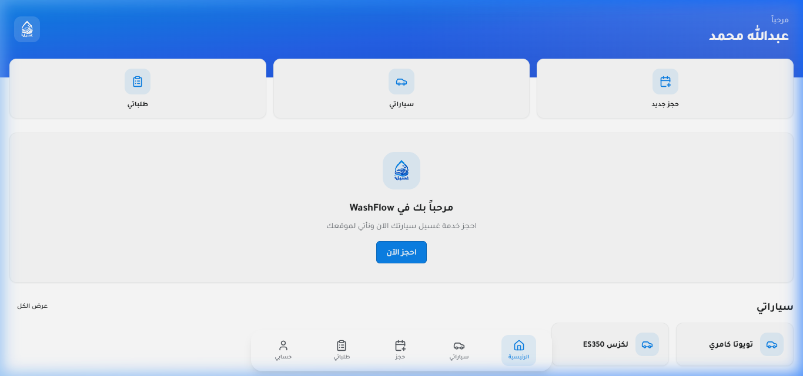
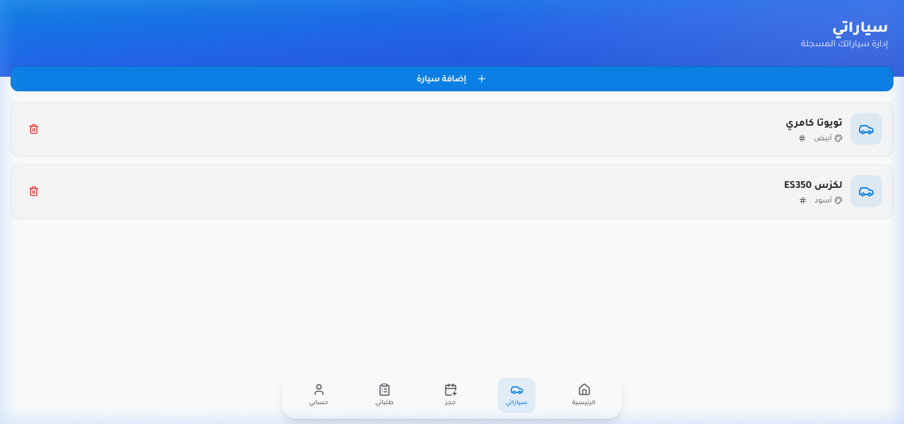
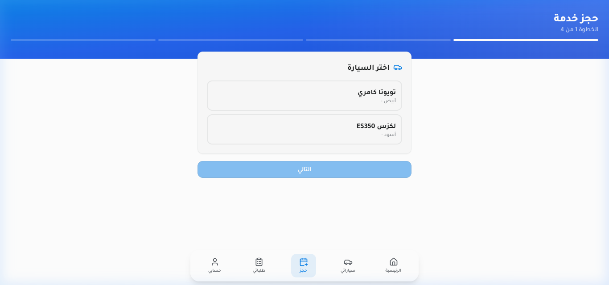
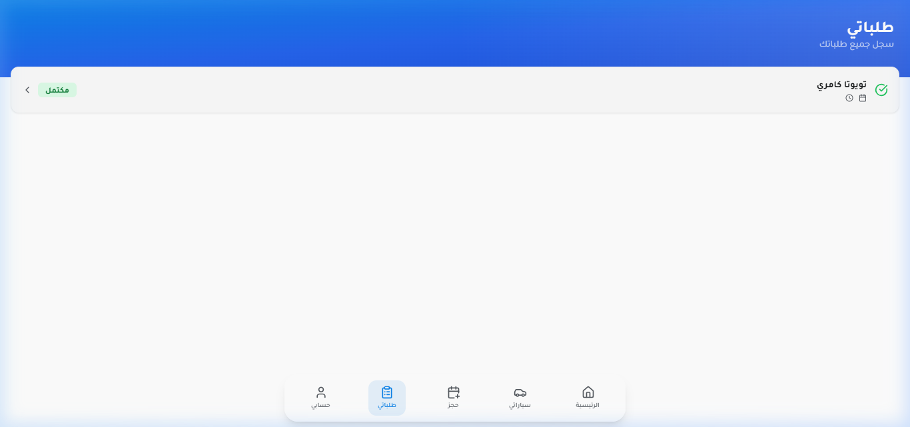
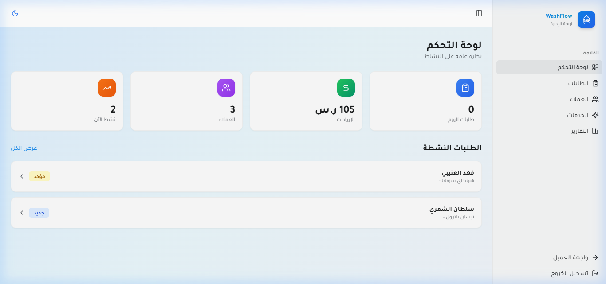
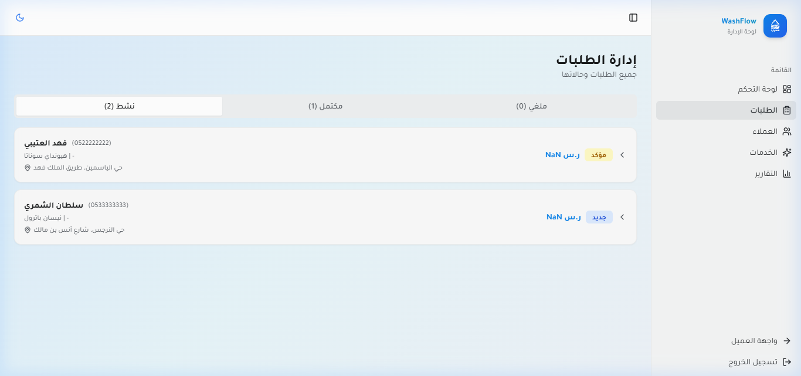
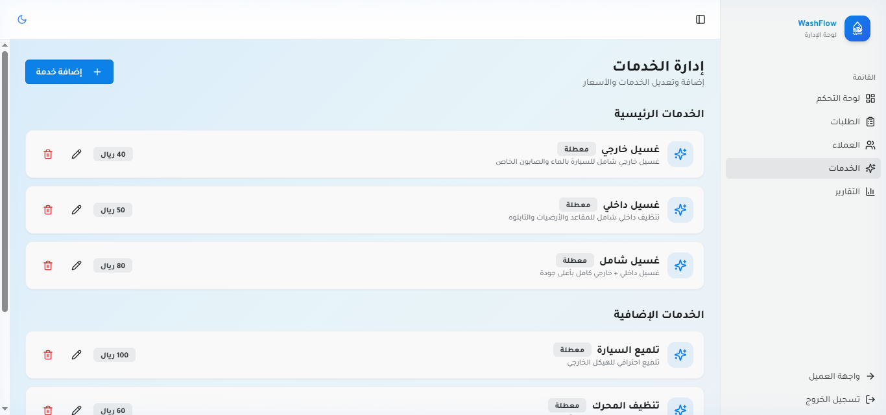
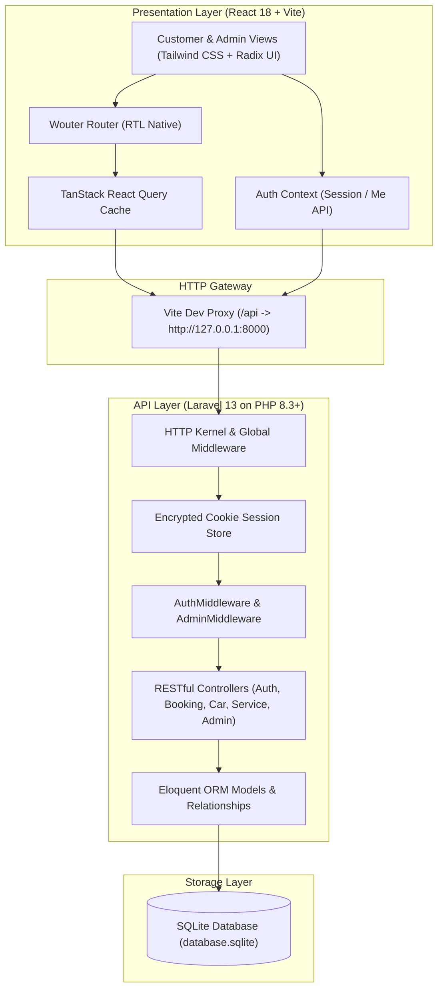

# WashFlow 🚗✨

> **Modern Full-Stack On-Demand Automotive Care & Fleet Dispatching Platform**  
> *Built with an API-only Laravel 13 backend and a responsive, glassmorphic React 18 Single-Page Application.*

[](LICENSE)
[](https://www.php.net/)
[](https://laravel.com)
[](https://react.dev)
[](https://www.typescriptlang.org/)
[](https://tailwindcss.com/)
[](https://www.sqlite.org/)

---

## 📌 Executive Summary

**WashFlow** is an open-source demonstration of a decoupled web architecture designed for on-demand field-service dispatching. It eliminates the friction of traditional car wash facilities by allowing vehicle owners to schedule mobile detailing directly to their doorstep, while providing service managers with an administrative dashboard to manage dispatching, inventory, and revenue.

The project demonstrates:
- **Decoupled Architecture:** Strict separation between the Laravel RESTful API and the React Single Page Application.
- **RTL-Native Design System:** Tailored for Arabic Right-to-Left workflows, enhanced with Radix UI, Framer Motion, and Tailwind CSS.
- **Zero-Friction Reviewer Experience:** Built-in SQLite database support and synthetic seeders allow technical reviewers to boot and test the entire stack in under two minutes without third-party services.

---

## 📸 Verified UI Walkthrough

All screenshots below are captured from the live running application using synthetic evaluation data.

| Customer Onboarding & Authentication | Customer Dashboard & Active Bookings |
|:---:|:---:|
|  |  |
| *OTP Phone Login & Feature Highlights* | *Real-time booking status & quick actions* |

| Customer Vehicle Garage | Interactive Booking Wizard |
|:---:|:---:|
|  |  |
| *Vehicle management & plate tracking* | *Multi-step service bundling & scheduling* |

| Customer Order Tracking | Admin Operations Dashboard |
|:---:|:---:|
|  |  |
| *Live order lifecycle & review submission* | *Revenue KPIs, volume counters & trends* |

| Admin Dispatching Queue | Dynamic Service Catalog Management |
|:---:|:---:|
|  |  |
| *Field operations dispatch & status updater* | *Pricing, categories, and service toggles* |

---

## 🏗 System Architecture

The application adopts a decoupled client-server model communicating over a standardized JSON REST API.



---

## 🚀 Quickstart & Setup Guide

### Prerequisites
- **PHP:** 8.2 or 8.3+ (PHP 8.5 tested)
- **Composer:** 2.x
- **Node.js:** v20.x or v22.x
- **NPM:** 10.x+

---

### Step 1: Clone the Repository
```bash
git clone https://github.com/hussainalkhamri/washflow.git
cd washflow
```

---

### Step 2: Backend Setup
```bash
cd backend

# 1. Install dependencies
composer install

# 2. Setup environment
cp .env.example .env
php artisan key:generate

# 3. Create SQLite database & run migrations with seeders
touch database/database.sqlite
php artisan migrate --seed

# 4. Start backend server (listens on 127.0.0.1:8000)
php artisan serve
```

---

### Step 3: Frontend Setup
In a new terminal window:
```bash
cd frontend

# 1. Install dependencies
npm install

# 2. Start Vite development server
npm run dev
```

Open your browser to **`http://localhost:5173`**.

---

## 🔑 Demo Login Accounts

For immediate reviewer evaluation, the database is pre-seeded with synthetic test profiles:

| Role | Phone Number | Demo OTP | Default Landed View |
|---|---|---|---|
| **System Admin** | `0500000000` | `1234` | `/admin` (Operations Dashboard) |
| **Customer (Tariq)** | `0511111111` | `1234` | `/customer` (Customer Dashboard) |
| **Customer (Fahad)** | `0522222222` | `1234` | `/customer` (Customer Dashboard) |

---

## 🧪 Testing & Code Quality

### Run Backend Tests (Pest / PHPUnit)
```bash
cd backend
php artisan test
```

### Run Frontend Static Typecheck
```bash
cd frontend
npm run check
```

### Build Production Bundle
```bash
cd frontend
npm run build
```

---

## 🔒 Security & Privacy Considerations

- **Demo OTP Simulation:** In this demonstration build, OTP verification statically accepts `1234`. This avoids third-party SMS gateway dependencies (Twilio, Unifonic) and API billing while enabling frictionless evaluation. Production deployment requires switching to a verified SMS provider driver.
- **Session API Authentication:** The API utilizes Laravel's native session middleware applied directly to `/api/*` routes with HTTP-only encrypted cookies and CSRF protection.
- **Zero Real PII:** All customer records, phone numbers, vehicle license plates, and street names are 100% synthetic fixtures.

---

## 📚 Technical Documentation

- [Architecture & Data Model Specifications](docs/architecture.md)
- [End-to-End User Journey Walkthrough](docs/user-journey.md)
- [RESTful API Reference](docs/api.md)
- [Testing & Quality Verification Matrix](docs/testing.md)
- [Security, Privacy, & Threat Assessment](docs/security-and-privacy.md)
- [Live Demo Script & Evaluation Guide](docs/demo-script.md)

---

## 👨‍💻 Author

**Hussain Alkhamri**  
- Email: [saleh7ussain@gmail.com](mailto:saleh7ussain@gmail.com)  
- GitHub: [@hussainalkhamri](https://github.com/hussainalkhamri)  

---

## ⚖️ License

Distributed under the **MIT License**. See [`LICENSE`](LICENSE) for terms.
