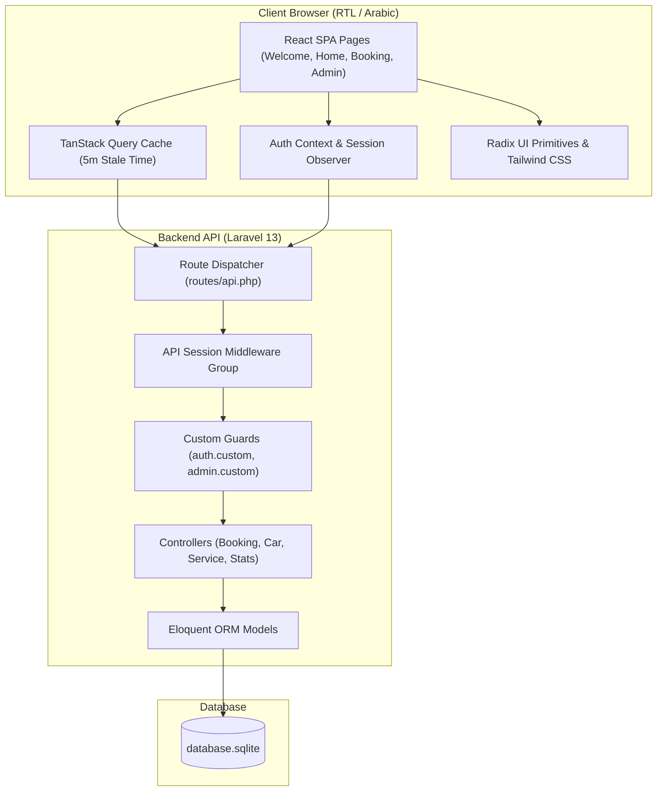
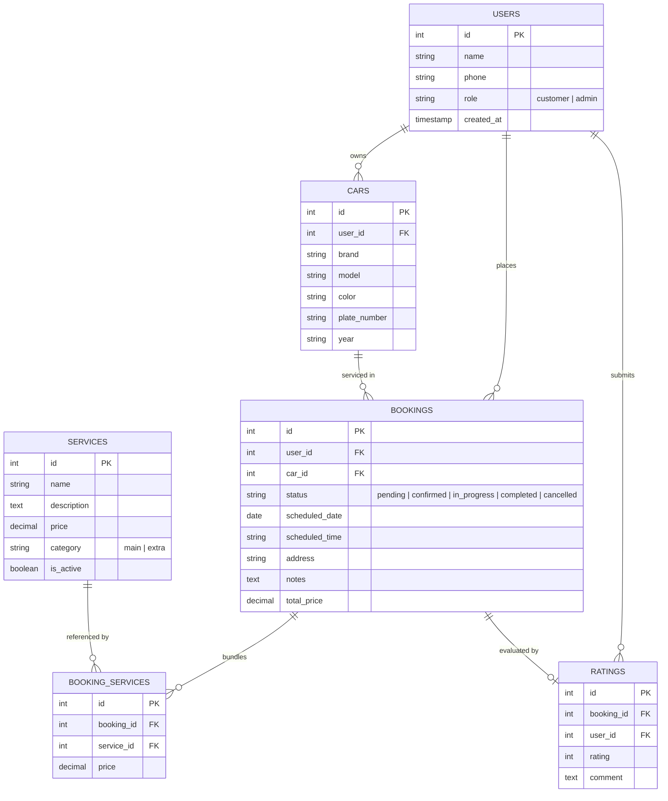

# System Architecture & Technical Specifications

**Document:** `docs/architecture.md`  
**System:** WashFlow  

---

## 1. Architectural Philosophy

WashFlow is engineered as a decoupled, multi-tier system with strict separation of concerns:
1. **Headless Backend (API Layer):** Built on Laravel 13 running on PHP 8.3+. It functions as a pure RESTful API server without server-side Blade presentation logic.
2. **Single Page Application (Client Layer):** Built on React 18 with TypeScript and Vite. It consumes JSON endpoints, manages asynchronous cache with TanStack React Query, and handles local state and routing via `wouter`.
3. **Relational Persistence Layer:** Backed by SQLite for portable zero-configuration demonstration, with normalized migrations compatible with MySQL and PostgreSQL.

---

## 2. Component Diagram

---

## 3. Entity-Relationship Data Model

---

## 4. Architectural Trade-offs & Decisions

| Decision | Selected Approach | Trade-off Analysis |
|---|---|---|
| **API Authentication** | Session-Cookie over JWT | Cookies marked `HttpOnly` and `SameSite` mitigate XSS token exfiltration compared to `localStorage` JWT tokens, while eliminating client-side refresh token rotation complexity. |
| **Routing** | Wouter over React Router | Wouter provides a minimalist ~1.5kB footprint while satisfying all required routing features (nested layouts, parameterized routes, and programmatic navigation). |
| **State Management** | TanStack Query v5 | Server state is handled asynchronously with cache invalidation on mutations (e.g. invalidating `['/api/bookings']` immediately updates counters), eliminating Redux boilerplate. |
| **Database** | SQLite with Eloquent | Ensures portable zero-configuration deployment for reviewers while preserving full migration compatibility with enterprise RDBMS like MySQL and PostgreSQL. |
